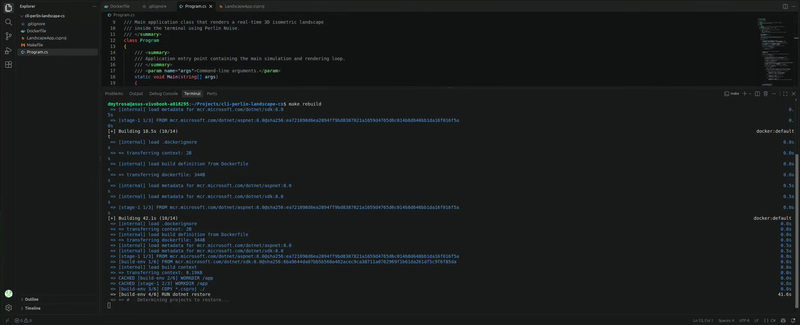

# Procedural 3D Isometric Noise Landscape Creator 🏔️


A real-time, interactive **3D isometric landscape generator** written in **C#** and executed within an isolated **Docker** container. It renders a continuously flowing procedural terrain directly into the Linux terminal (CLI) using 8-bit ANSI color sequences and custom ASCII typography layers.

---

## 🎮 Gameplay / Demo

Here is the simulation running inside an Ubuntu terminal:



---

## ✨ Key Features

- **True Text-Based 3D:** Uses an isometric projection matrix to transform `(X, Y, Height)` world space into a layered 2D terminal viewport.
- **Double-Buffered Renderer:** Prevents terminal flickering via custom grid buffers flushed to `STDOUT` in a single unified operation (~30 FPS).
- **ANSI Color Optimization:** Evaluates and emits xterm-256 color escape codes conditionally, lowering CPU load and reducing data stream overhead.
- **Zero Local Dependencies:** Fully dockerized workspace. You don't even need .NET installed on your host system to build and run.

---

## 🧠 Behind the Scenes: Math & Logic

### 1. Perlin Noise Algorithm (Шум Перліна)
Unlike simple random numbers (`Random.Next()`), which produce jagged and chaotic spikes, **Perlin Noise** is a gradient noise algorithm developed by Ken Perlin in 1983 (for which he won an Academy Award for Technical Achievement). 

It generates smooth, continuous, and natural pseudo-random transitions. In this project, we sample 3D noise `f(x, y, time)`. As the `time` variable increments, the landscape appears to drift infinitely like a flight simulation over a procedural world.

#### Where is it used in the industry?
- **Game Design:** Generating infinite terrain, caves, and biomes (e.g., *Minecraft*, *No Man's Sky*, *Terraria*).
- **Computer Graphics (VFX):** Simulating natural textures like marble, wood grain, clouds, smoke, and fire in movies and 3D modeling tools (Blender, Maya).
- **AI & Simulations:** Creating randomized realistic environments for training robotics or autonomous vehicle agents.

### 2. Painter's Algorithm (Алгоритм художника)
To render 3D objects without a GPU depth-buffer (`Z-buffer`), the program implements the **Painter's Algorithm**. It sorts and renders coordinates from back to front (`Y: 0 -> Max`). Newer foreground elements overlapping old ones naturally overwrite background blocks, resolving depth sorting issues perfectly for text grids.

---

## 🚀 Getting Started (Ubuntu / Linux)

Ensure you have **Docker** and **Make** installed on your machine.

### Available Makefile Commands

| Command | Action |
| :--- | :--- |
| `make build` | Compiles the C# source and bundles the app into a Docker image. |
| `make run` | Starts the container interactively (`-it`) with full terminal passthrough. |
| `make rebuild`| Invalidates Docker layer cache and pulls a fresh state from the source. |
| `make clean` | Erases dangling intermediate images and builder context cache layers. |

### Quick Start Pipeline

1. **Build the container:**
   ```bash
   make build
   ```
2. **Launch the 3D landscape:**
   ```bash
   make run
   ```
3. **Exit the simulation:** Press `Ctrl + C` anytime. The container will automatically shut down and wipe its footprint from memory thanks to the `--rm` flag.

---

## 📚 Further Reading & Deep Dives

Want to learn more about procedural generation and terminal rendering matrices? Check out these amazing resources:

* [Understanding Perlin Noise](https://adrianb.io/2014/08/09/perlinnoise.html) — An excellent, visually rich deep dive into math gradients.
* [The Book of Shaders: Noise](https://thebookofshaders.com/11/) — Great interactive examples of implementing noise maps.
* [Wikipedia: Isometric Graphics in Video Games](https://en.wikipedia.org/wiki/Isometric_video_game_graphics) — Architectural concepts behind classic game engines.
* [ANSI Escape Codes Handbook](https://gist.github.com/fnky/458719343aabd01cfb17a3a4f7296797) — The full handbook on how to control colors, fonts, and cursors inside the CLI.

---

## ⚖️ License
This project is licensed under the [MIT License](LICENSE) - feel free to modify, expand, or fork it for your own procedural tech demos!
